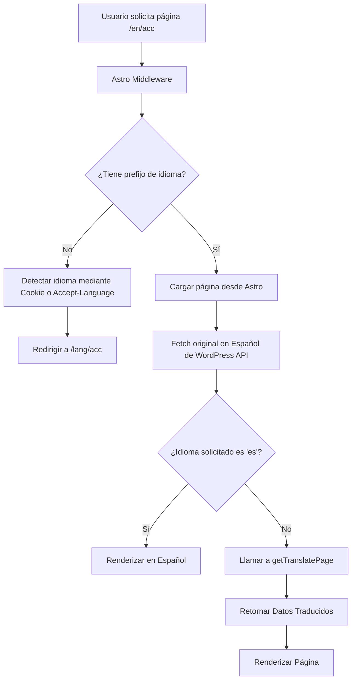

# Arquitectura de Localización e Integración con Google Gemini (gemini.md)

Este documento detalla el motor de traducción automática e internacionalización (i18n) del frontend del proyecto `TAMC`. Sirve como guía de referencia rápida para que cualquier IA o desarrollador entienda el flujo de datos de localización.

---

## 1. Flujo General de Internacionalización (i18n)

El proyecto soporta tres idiomas: **Español (`es` - por defecto)**, **Inglés (`en`)** y **Portugués (`pt`)**.



### Componentes Clave:
1.  **Middleware (`frontend/src/middleware.ts`):** Intercepta las solicitudes y valida si el primer segmento de la ruta es un idioma soportado. De lo contrario, detecta el idioma preferido del usuario mediante la cookie `locale` o la cabecera `Accept-Language` del navegador, y redirige.
2.  **Constantes (`frontend/src/consts/translation.ts`):** Define `SUPPORTED_LANGS`, `DEFAULT_LANG` y el `TRANSLATION_PROMPT` del sistema.

---

## 2. Motor de Traducción de IA (Gemini Integration)

Cuando se solicita un idioma distinto del predeterminado (`es`), el sistema llama al módulo de traducción dinámico ubicado en `frontend/src/lib/translation/`.

### 2.1 Archivos del Módulo
*   [index.ts](file:///mnt/data/dev/workspace/TAMC/frontend/src/lib/translation/index.ts): Contiene la lógica de comunicación con Gemini, la sanitización HTML, la extracción del JSON y los reintentos automáticos.
*   [cache.ts](file:///mnt/data/dev/workspace/TAMC/frontend/src/lib/translation/cache.ts): Controlador de persistencia y lectura de traducciones en base de datos.
*   [hash.ts](file:///mnt/data/dev/workspace/TAMC/frontend/src/lib/translation/hash.ts): Genera un hash SHA-256 del contenido original para invalidación inteligente de caché.
*   [translation.ts (utils)](file:///mnt/data/dev/workspace/TAMC/frontend/src/utils/translation.ts): Función integradora `getTranslatePage()` que combina el JSON original con el traducido.

### 2.2 Estrategia de Caché en Base de Datos
Para optimizar costos y tiempos de respuesta, las traducciones se cachean en la tabla `wp_translations` de la base de datos de WordPress usando **Drizzle ORM**:

```typescript
// Estructura del Caché (frontend/src/db/schema.ts)
export const wpTranslations = mysqlTable('wp_translations', {
    id: varchar('id', { length: 36 }).primaryKey(),
    fieldType: varchar('field_type', { length: 50 }).notNull().default('text'),
    locale: varchar('locale', { length: 10 }).notNull(),
    namespace: varchar('namespace', { length: 100 }).notNull(), // por defecto "pages"
    key: varchar('key', { length: 255 }).notNull(),             // Ej: "page_140"
    originalText: text('original_text').notNull(),
    translatedText: text('translated_text').notNull(),
    provider: varchar('provider', { length: 50 }).default('gemini'),
    hash: char('hash', { length: 64 }).notNull(),               // Hash de originalText
    createdAt: timestamp('created_at').defaultNow(),
    updatedAt: timestamp('updated_at').defaultNow().onUpdateNow(),
});
```

*   **Invalidación por Hash:** Al traducir, se genera un hash del JSON original. Si el contenido de la página cambia en el panel de WordPress, el hash resultante de la nueva consulta diferirá del hash guardado en caché, forzando una nueva traducción automática y actualizando la base de datos.

### 2.3 Parámetros de Gemini API
El cliente utiliza el nuevo SDK `@google/genai`:
*   **Modelo:** `gemini-2.5-flash-lite` (óptimo en velocidad y costo).
*   **Configuración:**
    *   `temperature: 0.1` (para evitar creatividad y garantizar fidelidad).
    *   `responseMimeType: "application/json"` (obliga a Gemini a retornar un JSON estructurado).
    *   `systemInstruction`: Definida en `TRANSLATION_PROMPT`, exige no traducir URLs, IDs, claves ni etiquetas de marcado HTML, y devolver solo el JSON.

### 2.4 Control de Rate Limits (Error 429)
El motor cuenta con un mecanismo de reintento ante el error `RESOURCE_EXHAUSTED` (límite de cuota):
1.  Detecta si el mensaje de error de la API contiene `retryDelay`.
2.  Extrae el valor del retraso indicado por la API y añade un margen de seguridad de 2 segundos.
3.  Pone el hilo en espera (`sleep`) y reintenta de forma recursiva hasta un límite de 2 reintentos adicionales.

---

## 3. Validación y Seguridad de Datos (Zod)

Para garantizar la robustez del frontend, el JSON retornado por Gemini se somete a validación estructural con Zod antes de ser renderizado o guardado en caché:

*   **Esquema de Entrada (`PageSchema`):** Valida los datos originales de la API REST.
*   **Esquema de Traducción (`PageTranslationSchema`):** Valida que el JSON devuelto por Gemini mantenga los campos traducibles intactos y con la estructura correcta (título, contenido, ACF, y las secciones con sus respectivas tarjetas).
*   Si la respuesta de la IA no coincide exactamente con `PageTranslationSchema`, se registra un error en consola y el sistema hace fallback silencioso al contenido original en español para no romper la interfaz del usuario.

---

## 4. Guías para Desarrolladores al Modificar el Contenido

Cuando agregues campos personalizados (ACF) en WordPress o modifiques la estructura de las páginas en el frontend:
1.  **Actualiza el Schema de Zod:** Añade el nuevo campo en `frontend/src/schemas/pages.ts` tanto en `PageSchema` como en `PageTranslationSchema` (si el campo requiere traducción).
2.  **Actualiza la Lógica de Mapeo:** En `frontend/src/lib/translation/index.ts` (función `translatePageData()`), asegúrate de incorporar el nuevo campo dentro de `payloadToTranslate` para que se envíe a Gemini.
3.  **Sanitiza el HTML:** Si el campo de WordPress acepta HTML, pásalo siempre por la función `sanitizeHtml()` antes de agregarlo al payload de traducción para eliminar atributos innecesarios y optimizar el consumo de tokens.
4.  **Actualiza la Reconstrucción del Objeto:** Modifica `frontend/src/utils/translation.ts` para mapear el campo traducido de regreso al objeto de la página final.
